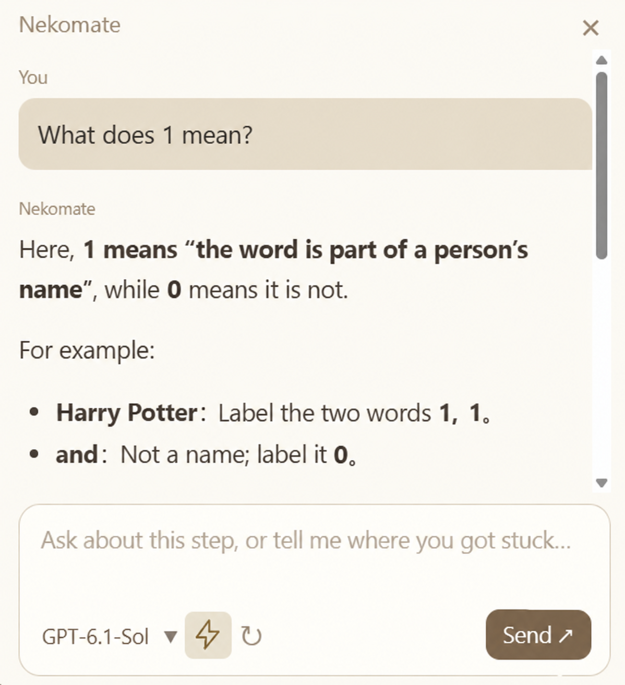

<p align="center">
  <a href="README.md">简体中文</a> | <strong>English</strong>
</p>

# Nekomate

Online lectures can be tough and fast-paced. You just want to ask an AI what the instructor meant by a particular word, but first you have to take a screenshot, rewind the video, and quote the entire sentence—only to get an answer that misses the point because the model lacks the full course context… Nekomate is here to help! No more taking screenshots or racking your brain over how to explain the course context to an AI. Your little cat classmate has you covered!

Nekomate is your little cat classmate, keeping you company during online classes. When something confuses you, just ask, “What does the orange rectangle on the slide mean?” You do not have to explain, “I'm taking a course on… The instructor was just talking about… Look at this screenshot and tell me what xxx means in that sentence. Earlier, they said…” Like a classmate sitting beside you, Nekomate follows the course and what the instructor was just explaining. Ask your question and get a clear, accurate explanation!

<div align="center">


<h1>Nekomate</h1>

<p><strong>Your little cat classmate. Let's learn together!</strong></p>
<p>Focus on your questions, with the context taken care of.</p>

<p>
  
  
  
  
</p>

<p>
  <a href="#preview">Preview</a> ·
  <a href="#quick-start">Quick start</a> ·
  <a href="#features">Features</a> ·
  <a href="#connections">Model connections</a> ·
  <a href="#faq">FAQ</a> ·
  <a href="#development">Development</a>
</p>

</div>

---

When something in a lecture confuses you, you may only want to ask, “What did the instructor mean by…?” But to help the model understand, you end up taking screenshots, rewinding the video, quoting the instructor, and filling in the background.

Nekomate handles that preparation in the background: it samples the course window you select, captures the current screen when you ask a question, transcribes the recent explanation, and adds the new material to your current learning conversation. Ask directly and follow up without introducing the course from scratch each time.

> “Why can we rearrange it like this?”　“What is $W$ here?”　“How does this relate to the earlier definition?”

<a id="preview"></a>

## Your little cat classmate, right there with you in class

<p align="center">
  
</p>

<p align="center"><sub>Chat preview, translated into English · Ask directly about what you do not understand in the course.</sub></p>

Click the cat to open the chat, then close the bubble to keep watching. Right-click to open settings, pause learning, or start a new learning session. Drag the cat off the edge of the screen to leave just two ears showing; move the mouse nearby to reveal a little forehead, then click to bring the cat back. While listening to class, the cat sits still with an open book in front of it.

<a id="quick-start"></a>

## Quick start

Available for **Windows 10/11 x64** and as a **macOS 14.2+ preview** for Apple Silicon and Intel. [Windows download](https://github.com/dmkom522/Nekomate/releases/tag/v0.1.2) · [Mac preview](https://github.com/dmkom522/Nekomate/releases/tag/v0.1.3-macos.1). You can also install Node.js 22+ (24 recommended) and run the following in a terminal:

```bash
git clone https://github.com/dmkom522/Nekomate.git
cd Nekomate
npm ci
npm start
```

Before the first launch from source, the local speech model and runtime are downloaded and verified, so an internet connection is required. You do not need to install Python separately. See the [license notes](#license) below for the binary release status.

1. **Connect a model.** Right-click the cat to open API Settings, then choose a service, connection method, and model that supports image input. API connections use your own key; CLI tools must be installed and signed in beforehand. Save your configuration before starting a learning session.
2. **Choose your course.** Select the browser, video player, or slide window you are watching, click hide, and your little cat will automatically start studying with you. On Windows, you can choose whether to capture system audio.
3. **Ask directly.** Click the cat and type what you do not understand. A fresh screenshot is sent together with your question, and the answer appears progressively in the chat bubble.

Nekomate does not include model credits. Usage fees, account permissions, and service limits are determined by your chosen API or CLI provider. See the [User Guide](docs/USER_GUIDE.md) for detailed instructions.

<a id="features"></a>

## Let Nekomate handle the context so you can focus on class

| Feature | What it does for you |
| --- | --- |
| Direct image input when you ask | Captures the current course screen and sends it with your question, saving you from taking screenshots or describing where to look. |
| Course context collected in the background | Automatic screenshots are at least 30 seconds apart, with no repeat submissions when the screen has not changed significantly. Visible concepts, formulas, and derivations are recorded. Early in a new conversation, Nekomate identifies the course; connections with web access can add relevant background. |
| Local speech transcription by default | Uses Qwen3-ASR 0.6B for Chinese and English. It prefers the GPU and falls back to the same model on the CPU when necessary. When you ask a question, it processes only audio from the last two minutes that has not already been transcribed. |
| One learning session, ongoing follow-ups | New images, transcripts, and questions are added to the current learning conversation. A separate conversation is created only when you start a new learning session; previous courses remain in history. |
| Recording continues while an answer is generated | Screenshots are saved and queued during answers, then processed into notes afterward. Pending screenshots already saved to disk can continue processing after a restart. |
| Organizing and reading | Search, rename, and delete history; keep separate input drafts; and read Markdown, LaTeX formulas, and code. Switch the interface between Chinese and English. |

The screen is sampled, and audio is retained in a rolling two-minute buffer. **This is not a full recording of the course.** If you go a long time without asking a question, older audio that has not been transcribed will be overwritten. Models can also misread formulas or terminology.

<a id="connections"></a>

## Use your own model

| Service | API connection | Local CLI |
| --- | --- | --- |
| OpenAI | Chat Completions | Codex CLI |
| DeepSeek | Direct DeepSeek API connection | — |
| Claude | Anthropic Messages | Claude Code |
| Other services / local APIs | OpenAI- or Claude-compatible formats | Either CLI above, using its own configuration |

**The selected model must support image input.** A service appearing in the list does not mean every model it offers can read images, or that your account has permission to use it. DeepSeek API connections go directly to DeepSeek, without routing through Claude Code.

CLI mode resumes the native session bound to the current learning conversation and appends new material. With a standard API, the application saves the complete conversation and sends the history according to the API protocol. Both are subject to model context limits and account usage limits. See the [Model Connection Guide](docs/CONNECTIONS.md) for setup instructions and interface requirements.

Local transcription does not need a separate speech API key. If the currently selected model is confirmed to support audio transcription, settings will offer “Use the selected model for audio transcription.” It is **off by default** and reuses the same connection when enabled.

<a id="faq"></a>

## FAQ

<details>
<summary><strong>Does Nekomate keep taking screenshots when learning is paused?</strong></summary>

No. Pausing learning stops new screen and audio capture, but pending screenshots saved earlier can still be processed into notes. Nekomate does not control the video player; you need to pause the video yourself.

</details>

<details>
<summary><strong>If the video keeps playing during an answer, will later content be missed?</strong></summary>

Screenshots continue in the background according to the sampling interval and screen-change rules. They are saved and queued, then processed after the answer finishes. Sampling can miss rapidly changing content. Pending screenshots confirmed as saved remain until their notes have been written successfully. Content that has not finished writing cannot be guaranteed to survive failures such as a power loss.

</details>

<details>
<summary><strong>Does a transcription failure prevent me from asking a question?</strong></summary>

The application shows a transcription error and still answers using the current screen and existing material. Without audio material, the model does not gain access to the instructor's exact words. On Windows, capture uses mixed system audio, which may include sounds from other applications. The microphone is not captured automatically.

</details>

<details>
<summary><strong>Where do screenshots, recordings, and keys go?</strong></summary>

Nekomate has no hosted backend, user accounts, or telemetry. Screenshots, questions, and transcript text are sent to the model service you choose. By default, raw audio is kept in a rolling buffer in local memory and transcribed locally. Audio is uploaded only when you explicitly enable transcription with your selected model.

Pending screenshots, learning records, and session data are stored locally. Submitted images may also remain in API conversations or native CLI history. Deleting a pending-image cache or the history shown in the interface does not delete your provider's or CLI's history. Keys are protected using the operating system's encrypted storage; if that service is unavailable, they are kept only in memory.

</details>

<details>
<summary><strong>Are macOS and Linux supported?</strong></summary>

Windows x64 and a macOS 14.2+ preview are available. The Mac preview has separate Apple Silicon and Intel installers and includes local transcription. On first use, grant screen recording and system audio recording permission in macOS. See the [Mac release notes](docs/MACOS_RELEASE_NOTES.md) for signing, verification scope, and known limitations. Linux compatibility has not yet been verified.

</details>

<a id="development"></a>

## Help make the cat better

We welcome course scenarios that leave you stuck, reproduction steps, and interface suggestions. Remove keys and personal information before sharing screenshots or logs.

| What you want to do | Start here |
| --- | --- |
| Learn everyday operations | [User Guide](docs/USER_GUIDE.md) |
| Configure an API or CLI | [Connection Guide](docs/CONNECTIONS.md) |
| Run, test, and build | [Development Guide](docs/DEVELOPMENT.md) |
| Understand test coverage and unverified areas | [Validation Notes](docs/VALIDATION.md) |
| Report issues or contribute code | [Issues](https://github.com/dmkom522/Nekomate/issues) · [Contributing Guide](CONTRIBUTING.md) |
| Report a security issue | [Security Policy](SECURITY.md) |

<details>
<summary><strong>Common development commands</strong></summary>

```bash
npm test              # Core logic and local interface tests
npm run check         # JavaScript syntax checks
npm run test:desktop  # Desktop integration tests
```

Automated tests, real window capture, and real model comprehension provide different levels of verification. See the validation notes for the scope of each.

</details>

<a id="license"></a>

## License and acknowledgments

Nekomate's own code is released under the [MIT License](LICENSE). Default speech transcription uses inference components from [Qwen3-ASR-GGUF](https://github.com/HaujetZhao/Qwen3-ASR-GGUF) and the Qwen3-ASR model. Third-party components are subject to their own terms; see the [Third-Party Notices](assets/licenses/SPEECH-NOTICES.txt).

Explicit redistribution permission for the currently pinned Qwen GGUF inference implementation has not yet been confirmed, so automatic publishing of installers containing it is disabled by default. The Qwen model's Apache-2.0 license is separate from the inference implementation's license. See the [provenance notes](assets/licenses/Qwen-GGUF-NOTICE.txt) for the recorded findings.

<div align="center">
  <sub>Make time for thinking.</sub>
</div>

## Contribute

Help improve Nekomate! [Open an issue](https://github.com/dmkom522/Nekomate/issues) to report a bug or suggest a feature, or [submit a pull request](https://github.com/dmkom522/Nekomate/pulls) to improve the code or documentation.

See the [Contributing Guide](CONTRIBUTING.md) for details.

Nekomate's own code uses the MIT License. Third-party models, inference implementations, and runtimes are subject to their own terms. See the [Third-Party Notices](assets/licenses/SPEECH-NOTICES.txt) for their sources.

Made for the moments that make you pause and think.
