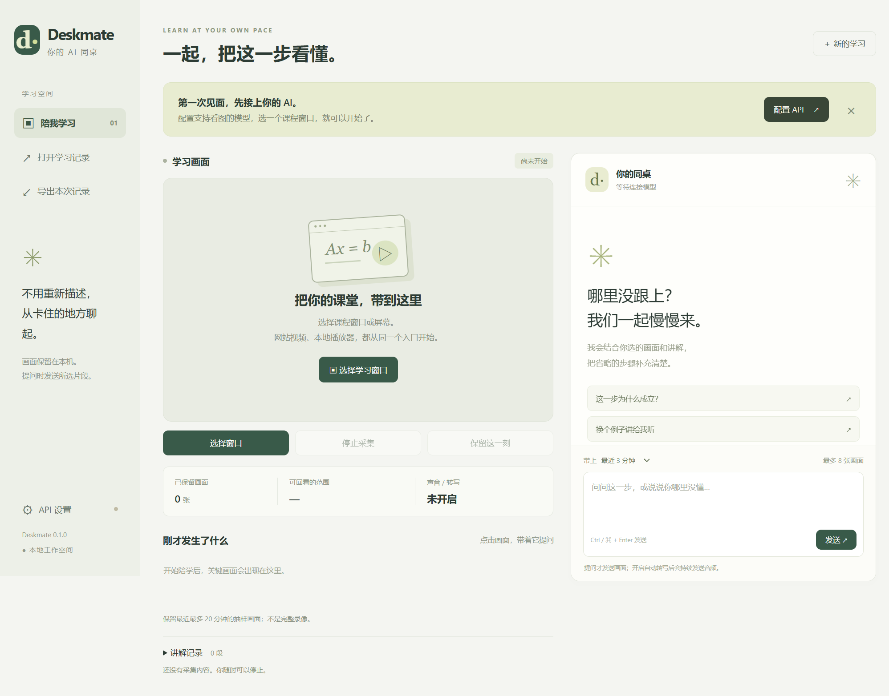

# Deskmate

**看懂每一步。你的 AI 同桌。**

看网课卡住时，不用重新整理前因后果。选择正在学习的窗口，Deskmate 会在本机保留近期画面；提问时把相关画面和可选的讲解转写一起交给你配置的模型。

独立桌面应用 · 自带 API · 中文界面 · 本地记录 · MIT 开源

[下载安装包](https://github.com/dmkom522/Deskmate/releases) · [使用指南](docs/USER_GUIDE.md) · [反馈问题](https://github.com/dmkom522/Deskmate/issues) · [开发与发布](docs/DEVELOPMENT.md)



## 下载使用

在 [Releases](https://github.com/dmkom522/Deskmate/releases) 下载 `Deskmate-版本-win-x64.exe` 安装程序。普通使用者**不需要 Node.js、Python 或开发环境**。

首版以 **Windows 10/11 x64** 为交付目标。macOS / Linux 保留源码构建入口，目前不承诺平台适配和系统声音可用。

1. 安装并打开 Deskmate。
2. 在 **API 设置**填写服务商的基础地址、视觉模型名称和自己的 API Key。
3. 点击 **选择学习窗口**，选择浏览器、播放器或其他课程窗口。
4. 看一段课程后，输入“这一步为什么成立？”；也可以先点击历史画面再提问。

Deskmate 不附带模型额度。API 费用由你选择的服务商收取。安装包尚未使用商业代码签名证书；Windows 可能显示未知发布者，请核对下载来源与 Release 提供的校验值。

## 它能做什么

- **选择窗口或屏幕**：带缩略图的应用内选择器，不需要抓取网站内部接口。
- **看图答疑**：保留公式、板书、代码和示意图的抽样画面。单次提问最多带 8 张图片。
- **可选的讲解转写**：Windows 系统声音按约 30 秒分段，发送到独立配置的语音转写接口。
- **连续追问**：自动携带近期对话，回答显示对应的画面 / 转写来源。
- **数学与代码呈现**：本地 Markdown、KaTeX 公式渲染，不依赖在线 CDN。
- **学习记录**：本机自动保存最近一次会话，支持导出和导入 JSON。
- **自选服务**：视觉与转写的地址、模型、密钥分别配置，支持无需密钥的本地兼容服务。

## 先了解这些边界

Deskmate 目前是 **0.1 早期版本**，还不是完整课程知识库。

- 画面是抽样，不是完整录像。最多保留最近 20 分钟、600 张、约 48 MB 的图片字符串，任一容量先到就移出旧画面。快速动画或推导可能遗漏。
- 提问时在所选时间范围内均匀选取最多 8 张画面，不做语义检索，也不保证找齐全部前提。
- 显示的是**陪学会话时间**，不是 B站等播放器的课程时间；暂不支持跳回原视频。
- 系统声音可能包含其他应用的声音，**不是仅所选窗口的声音**。默认关闭，也不自动采集麦克风。
- 最小化、受保护的视频或系统权限限制可能导致画面停止更新或黑屏。先看预览再开始。
- 未接收音频转写时，模型只有画面和对话。模型答复可能有误，应对照来源检查。
- 自动恢复只保留最近一次会话；开始新学习前可导出旧记录。关闭应用时最后约 10 秒的未保存变化可能丢失。

## API 兼容范围

| 功能 | 接口 | 必须支持 |
| --- | --- | --- |
| 视觉问答 | `POST {baseUrl}/chat/completions` | Chat Completions 多模态消息、base64 `image_url`、文字回复 |
| 语音转写（可选） | `POST {baseUrl}/audio/transcriptions` | multipart 文件上传、`model`、JSON `text` 返回 |

基础地址通常以 `/v1` 结尾，**不要再加 `/chat/completions`**。不是所有标注“OpenAI 兼容”的服务都支持图片或转写；仅支持文字的模型无法完成画面答疑。当前没有实现 Anthropic 原生 Messages、Gemini 原生 generateContent 或任意 Agent 协议适配。

## 隐私

应用没有 Deskmate 云端、用户账号、遥测或广告。密钥由 Electron `safeStorage` 调用操作系统的加密存储保护，渲染界面只能读取“是否已保存”。系统密钥服务不可用时仅保存在内存。

画面默认留在本机；**发送问题时**上传所选图片、相关转写与最近对话到你设置的服务地址。启用自动转写后，音频片段会持续发送到转写服务。窗口选择器缩略图不发给模型。API 服务商有各自的数据处理政策。

导出的 JSON 包含课程截图、讲解与对话，不含 API Key。分享记录前请自行检查内容。

## 从源码启动

开发者需要 Node.js 22+，建议 Node.js 24。

```bash
git clone https://github.com/dmkom522/Deskmate.git
cd Deskmate
npm ci
npm start
```

```bash
npm test             # 核心逻辑和真实本地 HTTP 请求测试
npm run check        # JavaScript 语法检查
npm run test:desktop # 桌面界面与模拟采集输入集成测试
npm run dist:win     # 生成 Windows x64 安装程序
```

开发测试、真实窗口采集和真实模型问答是不同层级的验证，详见 [验证说明](docs/VALIDATION.md)。

## 参与改进

欢迎提交 Bug、课程场景和改进建议。反馈时提供操作系统、应用版本、问题复现步骤，以及是否使用声音。不要上传 API Key 或未经检查的学习记录。

特别希望改进：更准确的片段选择、清晰的公式识别、长课记忆、可访问性和其他系统支持。详见 [贡献指南](CONTRIBUTING.md)。

MIT License · Made for the moment you say “等等，这一步我没懂”。
