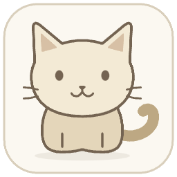
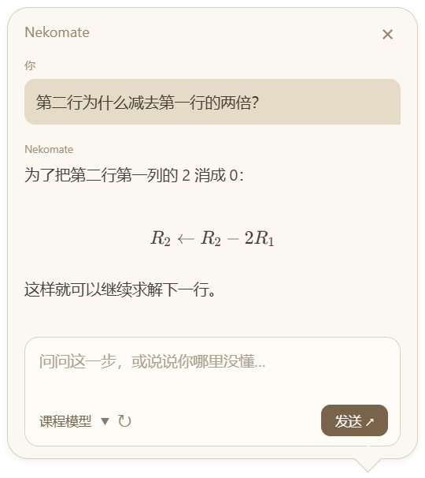

# Nekomate

网课内容太难，节奏太快，想要问大模型老师说的话是什么意思，只好先截图，再倒回去转述原话，程序却因为没有老师说话的上下文回答不到点子上？Nekomate来帮你！从此不用截图，不用绞尽脑汁思考如何给模型网课的上下文信息，你的小猫同桌会帮你解决一切！

Nekomate是你的小猫同桌，可以陪你一起听网课，当你遇到不懂的问题，直接问它：“ppt上的红色方块是什么意思？”，而不是“我现在正在上cs231n，刚刚老师在讲vit，结合画面告诉我老师‘.....这句话中的xxx是什么意思，前面他说.....’”。就像真的一直在陪你上课，它知道这节课在干什么，直接问它任何问题，然后等待它告诉你准确而清晰的答案！
<div align="center">



<h1>Nekomate</h1>

<p><strong>你的小猫同桌，一起听课吧！</strong></p>
<p>看课时，点一下小猫，问清没懂的那一步。</p>

<p>
  
  
  
  
</p>

<p>
  <a href="#preview">界面预览</a> ·
  <a href="#quick-start">快速开始</a> ·
  <a href="#features">核心功能</a> ·
  <a href="#connections">连接模型</a> ·
  <a href="#faq">常见问题</a> ·
  <a href="#development">参与开发</a>
</p>

</div>

---

听课卡住时，你可能只想问一句：“这个红色方块是什么意思？”但为了让模型明白，你得截图、回看视频、转述老师的话，再补上前面的背景。

Nekomate 把这些准备放到后台：抽样读取你选择的课程窗口，在提问时截取当前画面，转写最近一段讲解，并把新增资料送入当前学习对话。你可以直接问问题，接着追问，不必每次从头介绍这节课。

> “这一步为什么能这样变形？”　“这里的 $W$ 是什么？”　“和前面的定义有什么关系？”

<a id="preview"></a>

## 桌面上的小猫，随时接住你的问题

<p align="center">
  
</p>

<p align="center"><sub>聊天气泡预览 · 示例内容用于展示界面与公式排版</sub></p>

点击小猫展开聊天，关闭气泡后继续看课。右键打开设置、暂停学习或开始新的学习；把小猫拖到屏幕外，可以只留下两只耳朵，鼠标靠近时探出一点额头，点击后再回来。听课状态下，小猫面前会放一本书，保持静止。

<a id="quick-start"></a>

## 快速开始

当前提供 **0.1 源码预览**，面向 **Windows 10/11 x64**。准备 Node.js 22+（建议 24），在终端运行：

```bash
git clone https://github.com/dmkom522/Nekomate.git
cd Nekomate
npm ci
npm start
```

首次启动前会下载并校验本地语音模型与运行时，需要联网；无需单独安装 Python。二进制安装包的发布状态见下方[许可说明](#license)。

1. **连接模型。** 右键小猫打开 API 设置，选择服务、连接方式和支持图片输入的模型。API 使用自己的密钥；CLI 需提前安装并登录。保存配置后才能开始学习。
2. **选择课程。** 选择正在看的浏览器、播放器或课件窗口，确认预览，再开始学习。Windows 下可选择是否采集系统声音。
3. **直接提问。** 点击小猫，输入你没懂的地方。提问时的新截图直接和问题一起发送，回答会逐步显示在气泡中。

Nekomate 不附带模型额度。API 或 CLI 的使用费用、账户权限与服务限制由你选择的服务商决定。完整操作见[使用指南](docs/USER_GUIDE.md)。

<a id="features"></a>

## 少一点搬运上下文，多一点专心听课

| 功能 | 帮你做什么 |
| --- | --- |
| 提问时直接看图 | 截取当前课程画面，与问题一起交给模型，省去手动截图和描述位置。 |
| 后台积累课程背景 | 自动截图至少间隔 30 秒，画面无明显变化时不重复提交；记录可见的概念、公式和推导。新对话初期再集中识别课程，支持联网的连接可补充相关背景。 |
| 默认本地语音转写 | 使用 Qwen3-ASR 0.6B，支持中英文；优先使用显卡，不可用时切换同一模型的 CPU 模式。提问时只处理最近两分钟内尚未转写的声音。 |
| 一段学习，持续追问 | 新增画面、转写和问题进入当前学习会话。开始新的学习才建立另一段对话，旧课程保留在历史中。 |
| 回答期间继续记录 | 回答时截图先保存排队，回答结束后继续生成笔记；已落盘的待处理截图可在重启后接着处理。 |
| 整理与阅读 | 历史搜索、重命名、删除、独立输入草稿，以及 Markdown、LaTeX 公式和代码展示。界面可切换中文或英文。 |

画面使用抽样记录，声音只滚动保留最近两分钟，**不是完整课程录像**。长时间没有提问时，更早且未转写的声音会被覆盖。模型也可能误读公式或识别错术语。

<a id="connections"></a>

## 使用你自己的模型

| 服务 | API 连接 | 本机 CLI |
| --- | --- | --- |
| OpenAI | Chat Completions | Codex CLI |
| DeepSeek | 直接连接 DeepSeek API | — |
| Claude | Anthropic Messages | Claude Code |
| 其他服务 / 本地 API | OpenAI 或 Claude 兼容格式 | 可选上述 CLI，沿用其自身配置 |

**所选模型必须支持图片输入。** 服务出现在列表中，不代表它的每个模型都能读图，也不代表你的账户已经获得调用权限。DeepSeek API 直接连接，不经过 Claude Code。

CLI 模式恢复当前学习绑定的原生会话，后续追加新增资料；普通 API 由应用保存完整对话，按接口协议携带历史发送。两者都受模型上下文和账户用量限制。连接步骤与接口要求见[模型连接指南](docs/CONNECTIONS.md)。

默认本地转写不需要额外的语音 API 密钥。如果当前所选模型确认支持音频转写，设置里会提供“使用所选模型转写音频”，**默认不勾选**，启用后复用同一连接。

<a id="faq"></a>

## 常见问题

<details>
<summary><strong>暂停学习后还会截图吗？</strong></summary>

不会。暂停学习停止新的画面和声音采集，但之前已经保存的待处理截图仍可继续补成笔记。它不会控制视频播放器，视频是否暂停需要你自己操作。

</details>

<details>
<summary><strong>回答时视频继续播放，会错过后面的画面吗？</strong></summary>

后台仍按采样间隔和画面变化规则截图，先保存、排队，回答结束后继续读图。抽样可能错过快速变化的画面；已确认保存的待图会保留到笔记写入成功后再删除。尚未完成写入的内容无法保证在断电等故障中保留。

</details>

<details>
<summary><strong>转写失败会影响提问吗？</strong></summary>

应用会提示转写错误，仍结合当前画面和已有资料回答。没有声音资料时，模型不会因此获得老师的原话。Windows 采集的是系统混合声音，可能包含其他应用的声音，不会自动采集麦克风。

</details>

<details>
<summary><strong>截图、录音和密钥会发到哪里？</strong></summary>

Nekomate 没有自建云端、用户账号或遥测。截图、问题和转写文字会发给你选择的模型服务；原始录音默认只在本机内存中滚动缓存并本地转写，主动启用模型转写后才上传对应录音。

待处理截图、学习记录与会话数据保存在本机；已提交图片也可能留在 API 对话或 CLI 原生历史中。删除待图缓存或界面历史，不等于删除服务商或 CLI 的历史。密钥通过系统加密存储保护；该服务不可用时仅保存在内存。

</details>

<details>
<summary><strong>支持 macOS、Linux 吗？</strong></summary>

目前以 Windows x64 为目标。仓库保留其他平台的构建入口，但本地转写运行时、画面采集和系统声音尚未完成这些平台的适配验收。

</details>

<a id="development"></a>

## 一起把小猫打磨好

欢迎反馈让你卡住的课程场景、复现步骤和界面建议。提交截图或日志前，请移除密钥和个人资料。

| 想做什么 | 从这里开始 |
| --- | --- |
| 了解日常操作 | [使用指南](docs/USER_GUIDE.md) |
| 配置 API 或 CLI | [连接指南](docs/CONNECTIONS.md) |
| 运行、测试与构建 | [开发文档](docs/DEVELOPMENT.md) |
| 了解测试覆盖与未验证部分 | [验证说明](docs/VALIDATION.md) |
| 反馈问题、贡献代码 | [Issues](https://github.com/dmkom522/Nekomate/issues) · [贡献指南](CONTRIBUTING.md) |
| 报告安全问题 | [安全说明](SECURITY.md) |

<details>
<summary><strong>开发常用命令</strong></summary>

```bash
npm test              # 核心逻辑与本机接口测试
npm run check         # JavaScript 语法检查
npm run test:desktop  # 桌面集成测试
```

自动测试、真实窗口采集与真实模型理解属于不同层级的验证，具体范围见验证说明。

</details>

<a id="license"></a>

## 许可与致谢

Nekomate 自有代码采用 [MIT License](LICENSE)。默认语音转写使用 [Qwen3-ASR-GGUF](https://github.com/HaujetZhao/Qwen3-ASR-GGUF) 相关推理实现与 Qwen3-ASR 模型，第三方组件适用各自条款，详见[第三方说明](assets/licenses/SPEECH-NOTICES.txt)。

当前固定版本的 Qwen GGUF 推理实现尚未确认明确的再分发授权，因此默认关闭包含该实现的安装包自动发布；Qwen 模型的 Apache-2.0 许可不等于推理实现的许可。查验记录见[来源说明](assets/licenses/Qwen-GGUF-NOTICE.txt)。

<div align="center">
  <sub>留给那句“等等，这一步我没懂”。</sub>
</div>

## 参与改进

欢迎提交 Bug、课程场景和改进建议。反馈时提供操作系统、应用版本、问题复现步骤，以及是否使用声音。不要上传 API Key 或未经检查的学习记录。

特别希望改进：更准确的片段选择、清晰的公式识别、长课记忆、可访问性和其他系统支持。详见 [贡献指南](CONTRIBUTING.md)。

Nekomate 自有代码使用 MIT License。第三方模型、推理实现和运行时适用各自条款，来源说明见 [第三方说明](assets/licenses/SPEECH-NOTICES.txt)。

本地 Qwen 推理实现作为固定版本、校验摘要的构建依赖下载，不直接收录上游实现源码。已检查的 HaujetZhao 固定版本未找到独立 LICENSE 或明确的再分发许可；这与 Qwen 模型的 Apache-2.0 授权是两回事，查验事实见 [Qwen GGUF 来源说明](assets/licenses/Qwen-GGUF-NOTICE.txt)。默认 CI 运行测试，但不自动上传或发布包含该实现的安装包；维护者核实再分发授权后才能开启相应二进制发布步骤。仓库变量 `ALLOW_QWEN_BINARY_REDISTRIBUTION=true` 只控制工作流，不代表取得授权。

Made for the moment you say “等等，这一步我没懂”。
